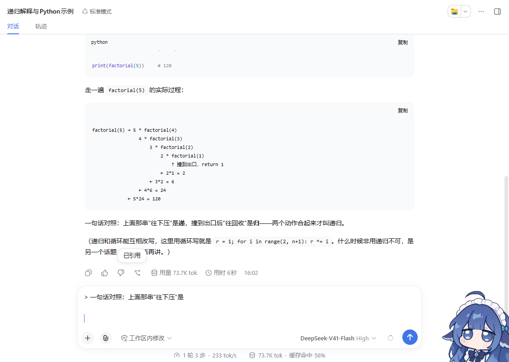
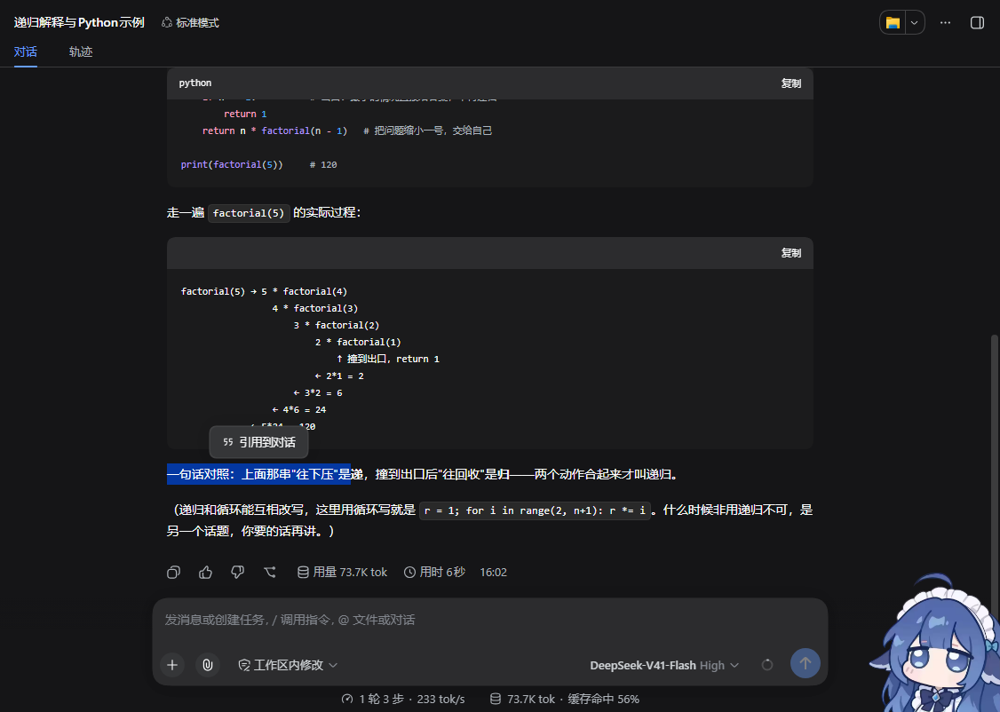

# dsh-selection-ask

[简体中文](README.md) | **English**

> A **select-to-quote** plugin for the [DeepSeek Harness](https://github.com/deepseek-ai/deepseek-harness) (DSH) web GUI.
> Select any text in the conversation, a small bar floats next to it, one click —
> the passage lands in the composer as a Markdown blockquote, with the caret
> already parked after it, ready for your follow-up question.




The same control on a dark host (colors come from the host's design tokens — the
plugin never guesses the theme):



---

## Why

Reading a long answer, you constantly want to point at **one specific sentence**:

> "Why is it written this way?" / "Expand on the third point."

Without this plugin that is: select → Ctrl+C → click the composer → Ctrl+V → then
start typing. And what you paste is shapeless raw text — the model cannot tell
which words are yours and which are quoted.

With it, quoting is one action and the structure is explicit:

```markdown
> A one-line contrast: pushing down is the "recurse", unwinding after hitting the
> base case is the "return" — only both together is recursion.

(your question goes here — the caret is already here)
```

A blockquote is plain Markdown, so the model can tell "this is what you quoted"
from "this is what you asked". **Quoting several passages in a row works too** —
each becomes its own block, separated by a single blank line.

---

## Install

```bash
# From GitHub (the repo ships a prebuilt lib/client.js — no build step for you)
dsh plugin --profile desktop add github:Eos010/dsh-selection-ask

# From a local working copy (use this while editing the source)
dsh plugin --profile desktop add file:D:\Work\dsh-selection-ask
```

> Replace `desktop` with the profile you actually run (the desktop app uses
> `desktop`; `dsh web` uses `web`).

**Restart DSH once afterwards**, then reload the page (`Ctrl+F5`).

That one restart is required because `dsh plugin add` registers the package in the
profile's `dsh.profile.bundles`, and that list is only read at startup. After the
restart you are in hot-reload territory: editing `lib/client.js` swaps the running
plugin within ~500 ms — no restart, no page reload (see *Development* below).

Uninstall:

```bash
dsh plugin --profile desktop remove dsh-selection-ask
```

(If `dsh-selection-ask` is still listed in the profile's
`dsh.profile.bundles`, drop that line too, then restart.)

---

## Usage

1. **Select a passage** in the web GUI — an AI answer, your own message, tool
   output, a code block, a file preview, anything;
2. A small bar floats next to it — click **"Add to conversation"**;
3. The passage becomes a blockquote in the composer, and the **caret is already
   after it**, so you just keep typing.

| Gesture | Result |
|---|---|
| Click elsewhere / `Esc` | The bar disappears (the composer is untouched) |
| Select text **inside the composer** | No bar — you are editing, not quoting |
| Selection longer than 8000 chars | Truncated, with a "selection truncated" notice |
| Quote two passages in a row | Two blocks appended, never overwritten |

---

## Boundaries (stated plainly)

- **Side conversations are not in this version.** This release only does
  "quote the selection into the composer". The other half of that Trae feature —
  *ask about the selection in a side panel* — needs a host half to call the model.
  See *Roadmap*.
- **It touches nothing but the draft.** It only calls DSH's own public
  `inputActions.setDraft()`, so undo history, attachments, and command mode all
  behave exactly as before.
- **No summarizing, no rewriting.** What lands in the composer is your selected
  text verbatim — only line endings are normalized and trailing blank lines
  dropped.
- **No network.** No telemetry, no external requests, not a single byte leaves
  the machine.

---

## How it works

```
index.mjs          Host half: an empty `apply() {}`
lib/client.js      Browser half: everything (prebuilt, committed)
client.js          Browser-half source
selection-ask.css  All styling
build.mjs          client.js + CSS → lib/client.js
```

The host half is **deliberately empty**. That deserves an explanation: a DSH
plugin is an entry in the host's Cordis tree, and the browser half is discovered
through the package's `dsh.client` declaration and served as a browser bundle —
which requires the package to already exist as an entry in the plugin tree. So a
pure-UI plugin still needs a node half, even an empty one (DSH's own
`dsh-client-ui-reference` is `function apply() {}` too).

Because the host half does nothing, it declares **no injected services at all**.
That is deliberate: declaring a service that is never provided leaves the fiber
PENDING, and the launcher's `assertEntriesActivated` then **drops the entire
plugin tree** — one plugin's typo can stop DSH from booting. Fewer declarations,
fewer ways to break the host.

### Why it mounts on `conversation.input.right`

There is exactly one supported way to write into the composer: DSH's public
`inputActions.setDraft()`. It is not handed to arbitrary plugins — it is delivered
as a **session-scoped slot standard prop**, only to slot occupants.

So the plugin takes one seat in the composer tool row (`conversation.input.right`).
That seat renders nothing but a `display:none` anchor; its purpose is twofold:

1. receiving `inputActions` and `useInput` (read/modify the draft);
2. using the anchor to **find the composer editor** — walking up from the anchor,
   the first ancestor containing a `contenteditable` is the composer card.
   **No host class name is hard-coded**, so restyling the host cannot break it.

### Why the bar is a portal

Rendering it in place would not work: the tool row may carry `overflow` /
`transform` / flex constraints, and a `position: fixed` element rendered inside
them gets absorbed by those constraints — it ends up glued to the tool row
instead of the selection. So the real bar is attached with
`ReactDOM.createPortal` to a host div under `document.body`, where fixed
positioning means what it says.

> ⚠️ One bug worth recording (it is commented in `selection-ask.css` too): the
> portal host sets `pointer-events: none` so that layer stays transparent to the
> page — but `pointer-events` is an **inherited** property, so the bar inherits
> "click-through" unless it sets `auto` back. The symptom is deceptive: the bar
> **renders, in the right place**, but every mouse event lands on the text below,
> so the "dismiss on outside mousedown" handler kills the bar before `click` ever
> reaches the button — it looks like **"I click and nothing happens, the bar just
> disappears."** Only a real click in a real browser catches this.

### When the bar does **not** appear

- The selection is inside an editable region (including the composer) or an
  `input` / `textarea` / `select` — you are editing;
- The selection is inside our own bar — no self-quoting;
- **A modal dialog is open** — modals live in the browser's top layer, above every
  z-index; the bar would be covered no matter how high its z-index, so it would
  only ever be "visible but unclickable", which is worse than absent. (Found the
  hard way on 2026-10-11, when the app's own beta-notice dialog covered it.)

---

## Development

Node ≥ 22. Zero runtime dependencies — React and react-dom come from DSH's
**platform module table** (`require("react")`), so no bundling and no second copy
of React.

```bash
node build.mjs                  # client.js + selection-ask.css → lib/client.js
node test/bundle.test.mjs       # bundle wiring: loader declaration, slot registration, styles, never throws
node test/selection.test.mjs    # pure logic: quote shape, draft composition, placement, exclusions
```

`lib/client.js` **is committed**: installing the plugin should not require a build
step. `build.mjs` doubles as a gate — it re-verifies the artifact (the placeholder
appears exactly once, the embedded CSS matches the `.css` file byte for byte, and
the sources did not change mid-build), so "edited the source, forgot to rebuild"
fails loudly.

### End-to-end acceptance (a real browser)

Unit tests cannot reach the DOM or real mouse events, so there is a second suite
driven over CDP that dispatches **real** mouse input and asserts against the
**real** DOM.

```bash
# 1) A separate test instance (never the one you are using)
dsh web --port 3099 --no-open

# 2) A Chrome with remote debugging, opened at the token URL the instance printed
chrome --headless=new --remote-debugging-port=9223 \
       --user-data-dir=<temp dir> "http://127.0.0.1:3099/?token=…"

# 3) Run it (the page needs a session with some content)
node test/e2e/selection-ask.e2e.mjs --cdp-port 9223 --app-url http://127.0.0.1:3099

# Also produces the README screenshots
node test/e2e/selection-ask.e2e.mjs --cdp-port 9223 --app-url http://127.0.0.1:3099 \
     --shots docs/images --theme dark
```

It checks 18 things, several of which only a real browser can check: the bar's
center point **hits the bar itself** (nothing covers it), `pointer-events` **was
not inherited into click-through**, the quoted block **equals the selected text**,
and a second quote **appends** instead of overwriting.

### Restart-free development install

While developing the plugin itself you can skip the restart: the profile's
`cordis.patch.yml` is **watched live** (`patchReload: live`), so wiring the plugin
in takes two steps —

```powershell
# 1) Link the package into the profile's node_modules (a junction, so editing the
#    working copy IS editing the running one)
New-Item -ItemType Junction -Path "$env:USERPROFILE\.dsh\profiles\desktop\node_modules\dsh-selection-ask" `
         -Target "D:\Work\dsh-selection-ask"

# 2) Append to the profile's cordis.patch.yml:
#    - insert:
#        - id: selection-ask
#          name: dsh-selection-ask
```

Run `node build.mjs` after editing `client.js` and the plugin is swapped in the
browser within ~500 ms (`dsh-client-hmr` polls the bundle's mtime/size every
500 ms).

---

## Data and privacy

- **No network**: no telemetry, no reporting, no external requests.
- **No file, credential, or conversation reads**: it does three things — read the
  current selection, call the host's public `inputActions.setDraft()`, and attach
  one floating layer to `document.body`.
- No options, therefore no config file.

---

## Roadmap

- **Next**: the other half of that Trae feature — **"ask in a side conversation"**:
  select a passage and ask about it in a separate panel, so the answer never enters
  the main thread. It needs a host half forwarding the question to
  `ctx.llm.stream()` and streaming it back (the browser cannot reach the model:
  DSH only exposes metadata remotes such as `llm/listProviders`). Note its
  boundary: such a panel carries only "the passage you selected + what you asked",
  with no tools, no file access, and no view of the main conversation — its value
  is answering in place without derailing the thread.
- Source labels on the quote (which message / which file and line).
- A keyboard shortcut (quote without going through the bar).

---

## License

MIT. See [LICENSE](LICENSE).
