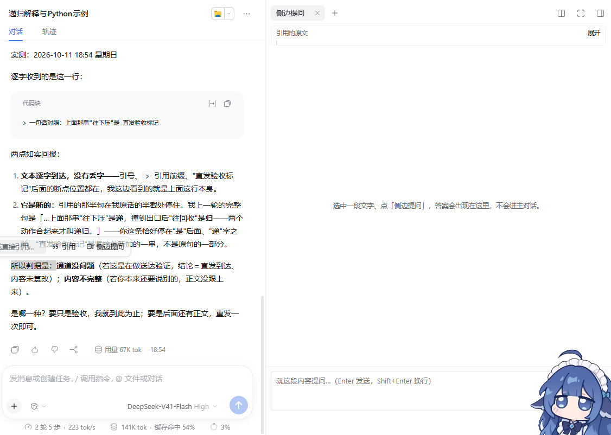
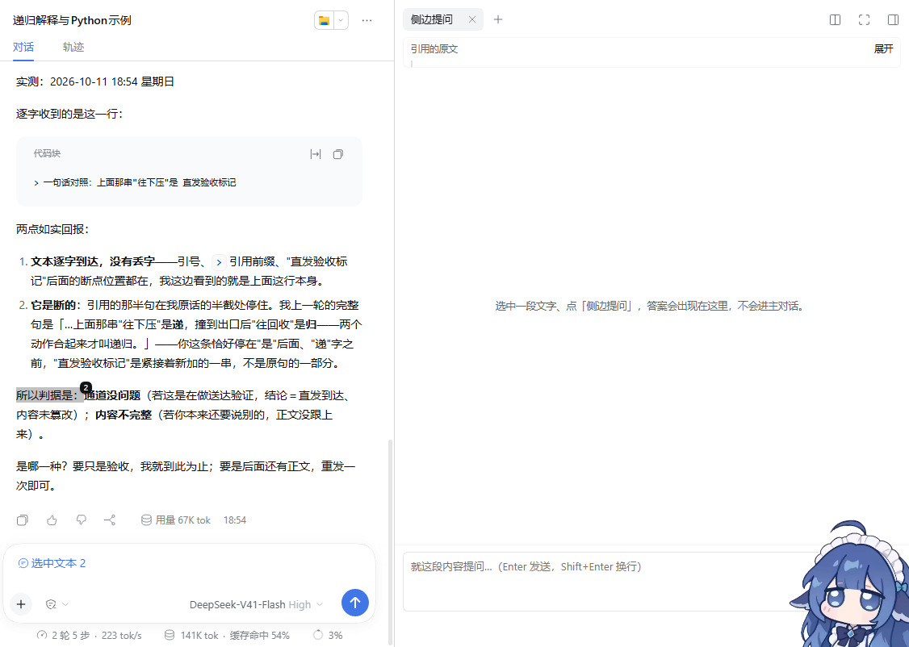
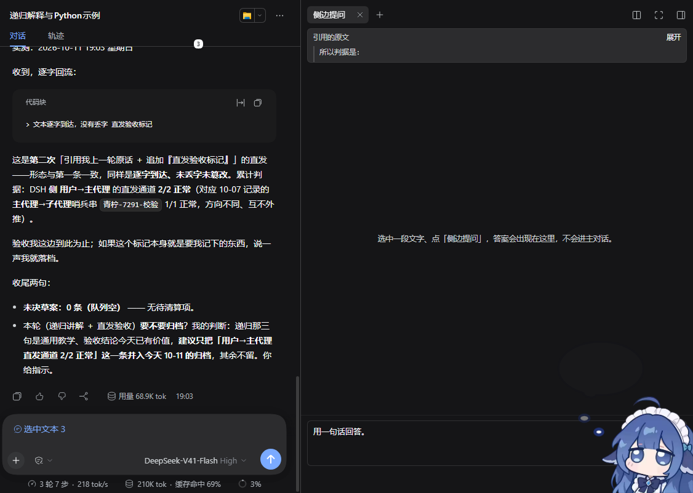

# dsh-selection-ask · 划词提问

**简体中文** | [English](README.en.md)

> 给 [DeepSeek Harness](https://github.com/deepseek-ai/deepseek-harness)（DSH）网页版用的**划词引用**插件。
> 在对话里选中一段文字 → 就地写批注 → 它变成**带编号的引用胶囊**落进输入框，
> 原文上同时留下**高亮和编号**；删掉胶囊，高亮和编号一起走。

选中之后（那片底色是插件自己接管的，不是浏览器的原生选区）：



回车提交之后（原文上有高亮 + 右上角编号，输入框里有胶囊）：



深色宿主下同一套控件（配色走宿主 design token，插件不自己判主题）：



---

## 它解决什么

读 AI 的长回答时，你经常想指着其中**某一句话**追问：

> "这里为什么这么写？" / "展开讲讲第三点" / "这句翻译成中文是什么？"

没有这个插件，你得手动选中 → Ctrl+C → 点输入框 → Ctrl+V → 再打字；
而且粘进去的是一段**没有形状**的裸文本，模型分不清哪句是你说的、哪句是你引的。

有了它，引用是一步动作，而且**引用是有身份的**：每一条引用有编号，原文上有对应的
高亮与编号牌，悬停胶囊能看回原文。模型收到的仍然是 markdown 引用块：

```markdown
> 一句话对照：上面那串"往下压"是递，撞到出口后"往回收"是归——两个动作合起来才叫递归。

（这里接着写你的问题，光标已经在这了）
```

---

## 一次引用的生命周期

**唯一事实源是"输入框里的胶囊"** —— 只有一套状态说了算，三个地方才不会各说各话：

```
胶囊在   →   原文的高亮在、编号在
胶囊没了  →   原文的高亮走、编号走
还没提交  →   那片选区由插件高亮接管（你永远看不到自己的选区凭空消失）
```

这就是为什么删掉输入框里的胶囊，原文上的高亮和编号会**跟着一起消失** ——
它们不是三份各自独立的记录，而是同一件事的三种呈现。

---

## 用法

1. 在网页里**选中一段文字** —— AI 的回答、你自己发过的话、工具输出、代码块，哪都行；
2. 光标旁浮出一条就地输入栏 —— 就地写批注，或者什么都不写；
3. `Enter` 写进输入框 / `Ctrl`（macOS 上 `Cmd`）`+ Enter` 写进输入框**并直接发送**。

| 动作 | 结果 |
|---|---|
| 选中正文 | 浮出就地输入栏；同时那片文字的底色**不会消失**（换成插件的同族高亮） |
| 就地输入栏里按 `Enter` | 写进输入框，**不发送** —— 你还能接着改、接着补 |
| 就地输入栏里按 `Ctrl/Cmd + Enter` | 写进输入框**并立刻发出去** |
| 写批注后提交 | 输入框里是 `[胶囊] 你的批注`（胶囊在前） |
| 悬停胶囊 | 浮出这条引用的原文 |
| **在输入框里删掉胶囊** | 原文的高亮与编号**同时消失** |
| 点别处 / 按 `Esc` | 收起浮层，不动输入框 |
| 在**输入框里**选中文字 | **不出**浮层 —— 那是在编辑，不是在引用 |
| 连续引用多段 | 每段各成一块，追加而不是覆盖 |
| 选中的内容超过 8000 字 | 截断，并提示「内容过长，已截断」 |

**编号的粒度**：一个页面生命周期内全局递增（`选中文本 1`、`2`、`3`…）；
同一段文字被再次引用时**复用原来的编号**（同一处标注不该有两个号）。

---

## 已知边界（说清楚，免得踩空）

1. **同一段文字在转录里出现多次时，高亮取第一处。** 锚定方式是"按原文文字找回来"
   （不存字符偏移 —— 转录是 React 按会话日志重渲染的，偏移一定会漂）。
2. **引用的原文必须落在单个文本节点内**（跨元素的选区锚不到）。
3. **转录虚拟化时，滚出屏幕的那段暂时不亮**，滚回来就恢复。这是这套锚定方式的边界，
   不是 bug。
4. **高亮依赖浏览器的 CSS Custom Highlight API**（Chromium 105+；DSH 桌面版与
   `dsh web` 都是 Chromium，实测可用）。不支持时高亮与编号**静默缺席**，
   但引用本身照常工作，并在控制台留一条告警。
5. **⚠ 侧边提问（未完成，封存中）**：浮层上那个「侧边提问」按钮能开出右侧栏面板、
   能把选中的那段带进去，**但面板里的发送按钮收不到真实鼠标点击**（已定位到原因：
   面板内 `pointerdown` 被 `preventDefault` + `click` 在冒泡到 React 根容器之前被拦，
   修法已写进 `项目档案`）。所以**它现在发不出问题**，默认别用它。
6. **热更新不可靠**：改完产物请**刷新页面**（`Ctrl+F5`）再看效果 ——
   HMR 在这台机器上实测不稳定（页面手里的 combo `rev` 会 404）。

---

## 安装

⚠️ 先纠一个坑（不少插件文档在这里是错的）：**DSH 的 CLI 会直接拒绝 `--profile desktop`** ——

```
$ dsh plugin --profile desktop add github:Eos010/dsh-selection-ask
error: profile "desktop" is managed exclusively by the Electron application
```

桌面版的 profile 由 Electron 应用独占管理。所以按你实际在用的版本二选一：

### 桌面版（Electron 应用）

在 DSH 应用内安装。也可以手动两步（**下面这套是实测跑通过的**）：

```powershell
# 1) 把仓库放进 profile 的 node_modules
git clone https://github.com/Eos010/dsh-selection-ask `
  "$env:USERPROFILE\.dsh\profiles\desktop\node_modules\dsh-selection-ask"

# 2) 在 ~/.dsh/profiles/desktop/package.json 的 dsh.profile.bundles 数组里加一行：
#      "dsh-selection-ask"

# 3) 重启 DSH，然后刷新网页（Ctrl+F5）
```

### 命令行版 `dsh web`

```bash
npm i -g pnpm        # dsh plugin 是 pnpm 的转发器，PATH 上得先有 pnpm
dsh plugin --profile web add github:Eos010/dsh-selection-ask
```

（从本地工作副本装，就把 `github:…` 换成 `file:<你的工作副本路径>`。）

**两种方式装完都要重启一次 DSH**，然后刷新网页（`Ctrl+F5`）。
为什么必须重启这一次：安装会把本包登记进 profile 的 `dsh.profile.bundles`，
而那个清单**只在启动时读一次**。

卸载就是反过来：从 `dsh.profile.bundles` 删掉那一行、删掉 `node_modules` 下的目录，重启。

---

## 怎么实现的

### 两半结构

```
index.mjs          宿主半边：一个流式问答端点（+ 两道安全门）
client.js          浏览器半边：全部交互（源码）
ask-panel.js       浏览器半边：侧边提问面板（源码，与 client.js 拼进同一个 bundle）
selection-ask.css  全部样式
build.mjs          ask-panel.js + client.js + CSS → lib/client.js（产物已提交）
lib/client.js      构建产物，宿主真正加载的就是它
```

宿主半边**不声明任何 `inject` 服务**。这是刻意的：DSH 的插件是宿主 Cordis 树上的一个
entry，客户端半边由这个 entry 带出来 —— 所以纯 UI 插件也得有 node 半边；但**声明一个
拿不到的服务**会让 fiber 停在 PENDING，启动器的 `assertEntriesActivated` 会因此
**丢掉整棵插件树**。少声明一个，就少一条把宿主搞挂的路。

### 为什么挂在 `conversation.input.right` 这个插槽上

要把字写进输入框，只有一条正路：DSH 公开的输入动作。而它只作为**会话作用域插槽的
标准属性**发给插槽组件。所以本插件在输入框工具行里占一格，那一格本身只画一个
`display:none` 的锚点 —— 它的意义有两件：拿到 `inputActions` / `useInput`，
以及**用锚点反查输入框编辑器**（从锚点往上走，第一个包含 `contenteditable` 的祖先）。
**不写死任何宿主类名。**

锚点还有第三个用途：**数输入框里现在还剩几个胶囊** —— 这是"引用的生命周期"的判据
（见上）。判据与悬停预览取 label 的方式**逐字相同**，两处判据不一致会出现
"悬停能看原文、但高亮判定说这个胶囊不存在"这种自相矛盾的行为。

### 引用胶囊：借的是官方机制

DSH 的输入框是 Lexical，`@文件` / `@对话` 插进去的就是**原子引用胶囊**。本插件注册一个
自己的引用源，`codec.serialize(ref)` 决定**发送时这条引用展开成什么文本** ——
所以胶囊只是**显示形态**变了，模型收到的仍然是 `> 引用原文`。

三个踩出来的硬知识（都在 `项目档案` 里有完整记录）：

- **`ctx.emit` 没有返回值，要用 `ctx.bail`**。输入机的四个事件声明是 `@mode bail`；
  用 `emit` 的返回值判成败 ⇒ 明明插进去了却判成失败 ⇒ 兜底的全文替换再把刚插好的
  胶囊抹掉。表象是"胶囊永远不出现"。
- **`InputState.draft` 是剪贴板投影，不是编辑坐标**。胶囊在编辑坐标里几乎不占位，
  在投影里占一大段。拿前者的长度去定位后者，永远定位不到。
- **插入位置不能只算一个，要"候选逐个试、让返回值挑"**。投影与坐标换算**并不总是
  对得上**：一旦对不上，唯一的候选会被拒，第二次引用就**静默失败**（兜底又因为
  "草稿里已有胶囊"拒绝写入，用户看到的是"点了没反应"）。所以有胶囊时还会补一层
  小整数阶梯（`胶囊数+1 … 0`，降序）—— 实测追加位置总落在这个范围里。

### 原文高亮与编号

- **高亮走浏览器原生的 CSS Custom Highlight API**（`CSS.highlights` + `Highlight`，
  实测色值：待定态 `rgb(212,212,213)`、已标注 `rgb(193,193,194)`，都是宿主 brand token
  按 18% / 26% 混出来的）—— **一个字节的 DOM 都不改**，所以 React 重渲染冲不掉它。
  （插 `<mark>` 再靠 MutationObserver 重挂，在流式输出的转录里会一直和 React 打架。）
- **编号牌放在我们自己的浮层里**，按 Range 位置贴上去，**不插进正文**；找不到就什么都
  不做，异常全吞 —— **绝不允许因为标注失败连累引用本身**。
- **待定高亮是必须的**：就地输入栏一出现就自动聚焦，而"聚焦一个 input"会让浏览器
  **当场清掉文档选区** —— 松手之后那片蓝色就没了，看起来就是"选完就消失"。
  所以我们用自己的高亮**接管**那一片：同族色、比"已标注"浅一档，视觉上是
  **换了个颜色**，不是消失。它用的是**活的 DOM Range**，只在浮层开着时存在。

### 什么时候**不**出浮层

- 选区落在可编辑区（含输入框自己）、`input` / `textarea` / `select` 里 —— 那是在编辑；
- 选区落在我们自己画的浮层里 —— 避免自引用套娃；
- **页面上有模态对话框开着** —— 模态框走浏览器 top layer，盖在所有 z-index 之上，
  让它出现就只是"看得见、点不着"，比不出现更糟。

### 主键还按着就不出浮层（拖拽事故的教训）

**症状**：鼠标按住拖，根本选不中字，一拖就断。
**根因**：选区一变成非空就触发 `selectionchange`，浮层立刻弹出来并自动聚焦输入栏；
而"聚焦一个 input"会让浏览器**当场结束这次拖拽并清掉选区**。
**为什么端到端全绿也没抓到**：`Input.dispatchMouseEvent` 的拖拽是**一瞬间**派发完的，
浮层还来不及插进去 —— **真人手速比测试慢，慢就会被自己的浮层打断**。
修法三条：主键按着时什么都不做、键盘选出来的选区不抢焦点、焦点在自己 DOM 里时
不因"空选区"而收起。量具也改了：**24 步、每步隔一帧**的慢速拖拽成了常驻断言。

---

## 开发

只需要 Node ≥ 22。运行时零依赖 —— React / react-dom 从 DSH 的**平台模块表**里取
（`require("react")`），不打包、不重复引入第二份 React。

```bash
node build.mjs                       # 源码 + CSS → lib/client.js
node test/bundle.test.mjs            # 15 项：产物接线、插槽注册、样式落点、失败不抛
node test/selection.test.mjs         # 36 项：引用块形状、草稿拼接、生命周期、浮层落位
```

`lib/client.js` **是提交进仓库的构建产物**：装插件的人不该被迫先跑一次构建。
`build.mjs` 同时是一道闸门 —— 它会把产物反过来校验一遍（占位符恰好出现一次、
内嵌 CSS 与 `.css` 文件逐字节一致、构建期间源码未被改写），任何"改了源码忘了重新构建"
都会当场报错。

### 端到端验收（真浏览器）

单元测试碰不到 DOM 与真实鼠标事件，所以另有一套 CDP 驱动的验收：它派发**真实**的
鼠标事件序列，读**真实**的 DOM 与**真实的 `CSS.highlights`** 来判定。

```bash
# 1) 起一个独立的测试实例（不要拿你正在用的那个）
dsh web --port 3099 --no-open

# 2) 起一个开了远程调试的 Chrome，打开实例打印出来的那个带 token 的 URL
chrome --headless=new --remote-debugging-port=9223 \
       --user-data-dir=<临时目录> "http://127.0.0.1:3099/?token=…"

# 3) 跑验收（需要在页面上打开一个**有内容**的会话）
node test/e2e/selection-ask.e2e.mjs --cdp-port 9223 --app-url http://127.0.0.1:3099

# 顺带产出 README 用的截图（深浅各跑一遍）
node test/e2e/selection-ask.e2e.mjs --cdp-port 9223 --app-url http://127.0.0.1:3099 \
     --shots docs/images --theme dark
```

**43 条断言**，其中几条只有真浏览器抓得到：

- 浮层中心点 **`elementFromPoint` 命中自己**（没被别的层盖住）、`pointer-events`
  **没有被继承成穿透**；
- **24 步慢速拖拽**中途不出浮层、选区不归零，松手后才出浮层；
- 三个状态的**真实高亮**：选中时待定高亮 `size === 1`、提交后归 0 且标注高亮为 1、
  **删掉胶囊后标注高亮与编号牌一起归 0**；
- **直发**：`Ctrl+Enter` 之后输入框被清空、那条消息出现在正文里；
- 整轮下来**没有未捕获异常** —— 这条是量具的保险丝：只在事件回调里抛的
  `ReferenceError`，页面看着一切正常，坏的只是那一个动作。

> ⚠️ **跑一次 E2E 会真的向模型发一条很短的请求**（验"直发"和"侧边提问"两条路径）。
> 它用的是你在测试实例里配的模型，注意额度。

### 装进正在运行的那份（免重启）

profile 的 `cordis.patch.yml` 是**被实时监视的**（`patchReload: live`）：

```powershell
# 1) 把包挂进 profile 的 node_modules（目录联接，改工作区源码就是改运行中的那份）
New-Item -ItemType Junction -Path "$env:USERPROFILE\.dsh\profiles\desktop\node_modules\dsh-selection-ask" `
         -Target "<你的工作副本路径>"

# 2) 往 profile 的 cordis.patch.yml 末尾追加：
#    - insert:
#        - id: selection-ask
#          name: dsh-selection-ask
```

改完源码跑一次 `node build.mjs`，**然后刷新页面**（`Ctrl+F5`）。
（`dsh-client-hmr` 会每 500ms 轮询 bundle 的 mtime/size，但它在本机实测不稳定 ——
页面手里的 combo `rev` 可能已经过期，表现为 bundle 404。**刷新才是可靠路径**，
所以这里不承诺热更新。）

---

## 数据与隐私

- **浏览器半边不联网**：不读文件、不读凭据、不读会话内容，只做三件事 ——
  读当前选区、调用宿主公开的输入动作、往 `document.body` 挂浮层。
- **⚠ 宿主半边有一个 HTTP 端点**：`POST /plugins/dsh-selection-ask/ask`
  （「侧边提问」用）。它把问题转给你**已配好的**模型并流式吐回浏览器 ——
  也就是说，**它花的是你的额度**。
  DSH 的 cookie 鉴权**只保护没被命名路由接管的请求**，所以插件自己加了两道门：
  **Host 必须是 IP 字面量或 localhost**（挡 DNS rebinding）+
  **带 Origin 就必须同源**（挡跨站）。实测：无 Origin 200 / 同源 200 /
  跨站 403 / Host 是域名 403。
- 没有配置项，也就没有配置文件。

---

## 路线

- **修掉侧边提问面板里的发送按钮**（原因已定位，见「已知边界」第 5 条）——
  等要做的时候从那里接着走。
- 引用块可带**来源标注**（摘自哪条消息 / 哪个文件第几行）。
- 快捷键：选中之后直接按键引用，不经过浮层。
- 高亮的三个已知边界（见上）**不打算改**：这套锚定方式选的就是"稳定能用"。

---

## 许可

MIT。见 [LICENSE](LICENSE)。
